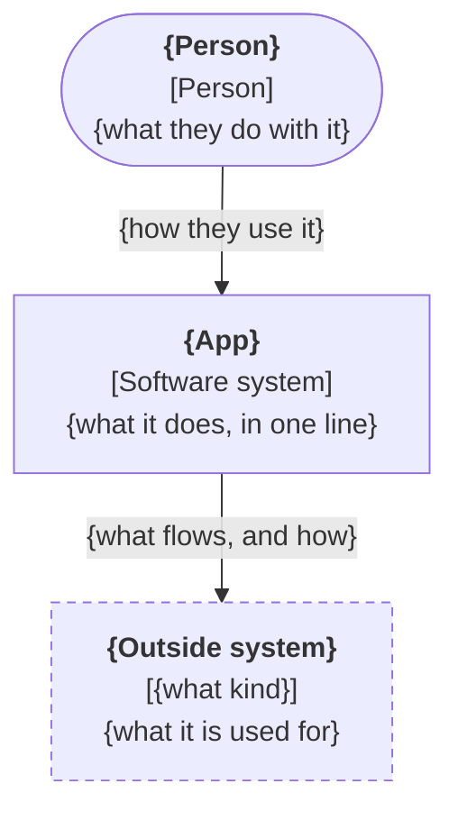
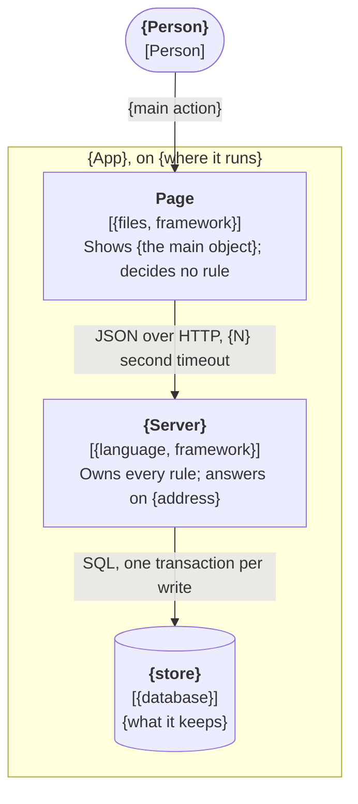
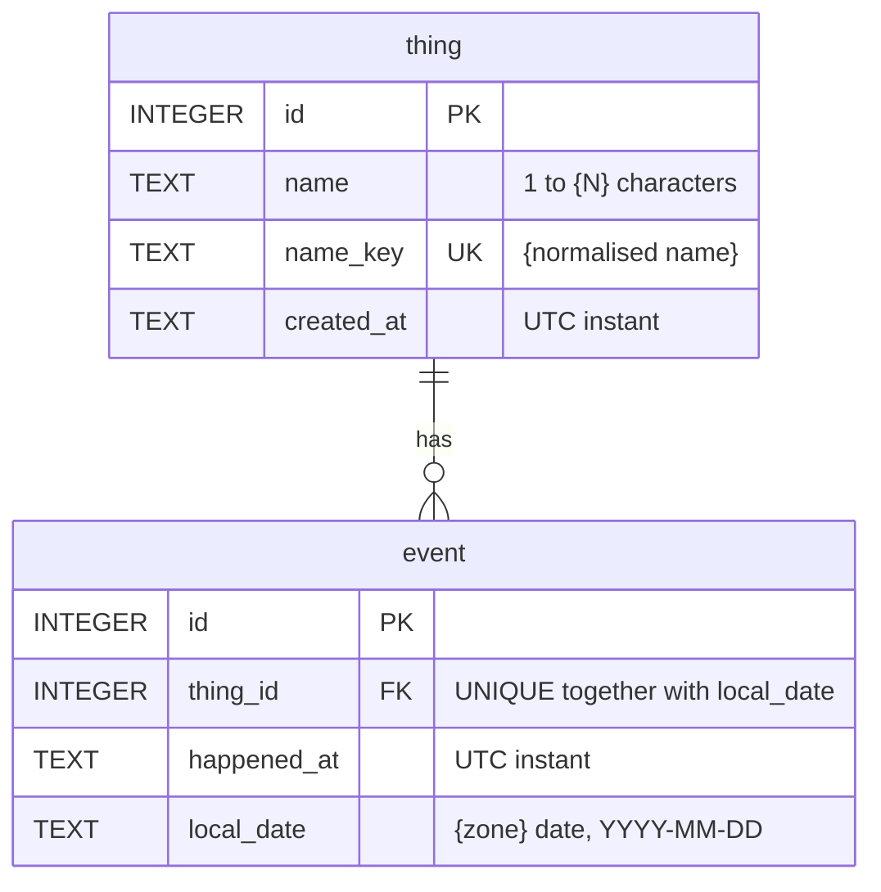
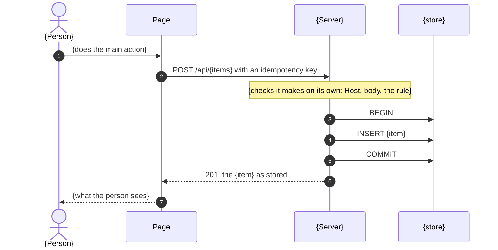
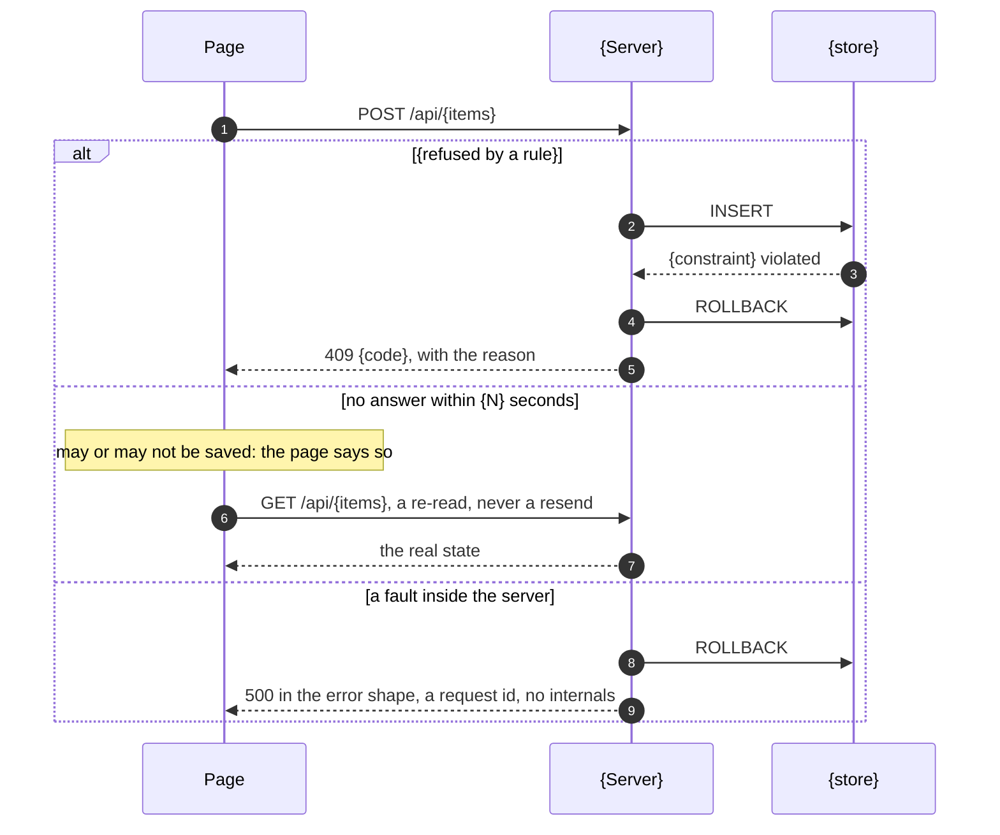
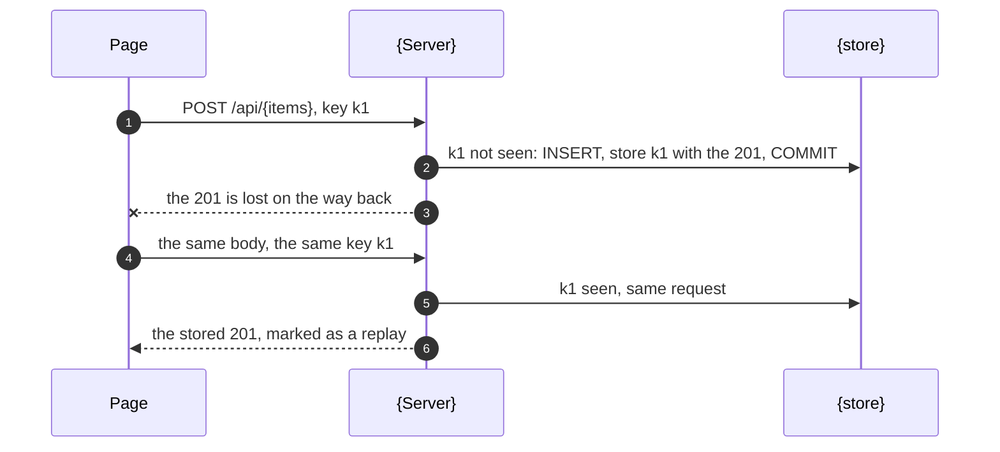
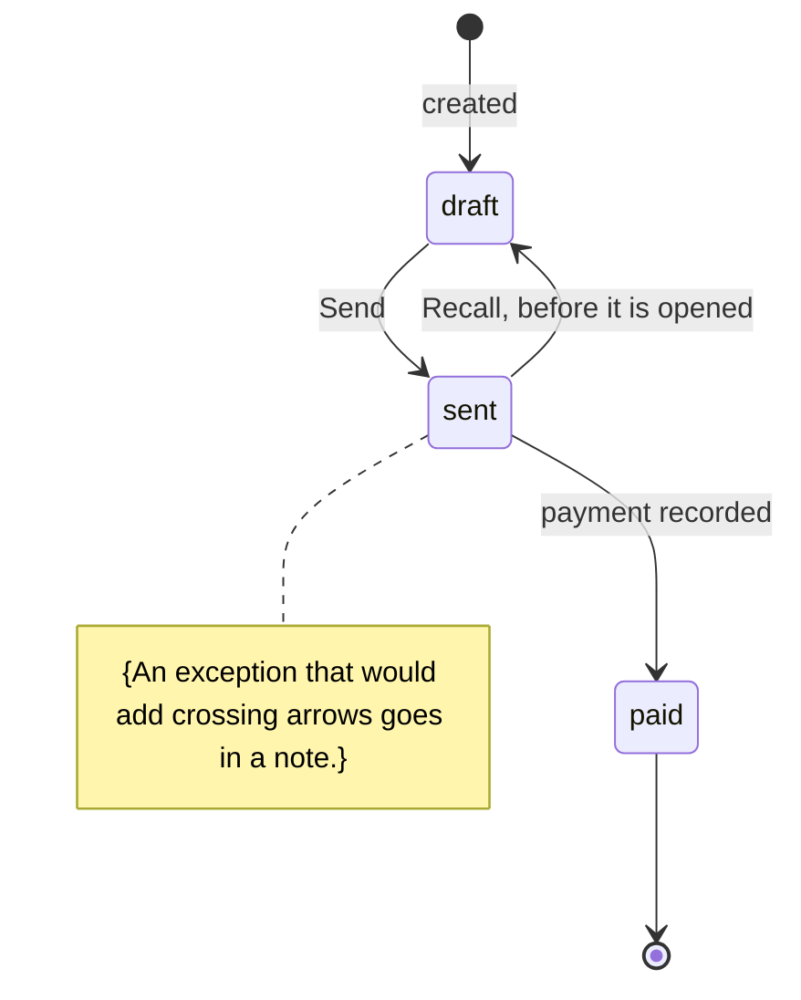
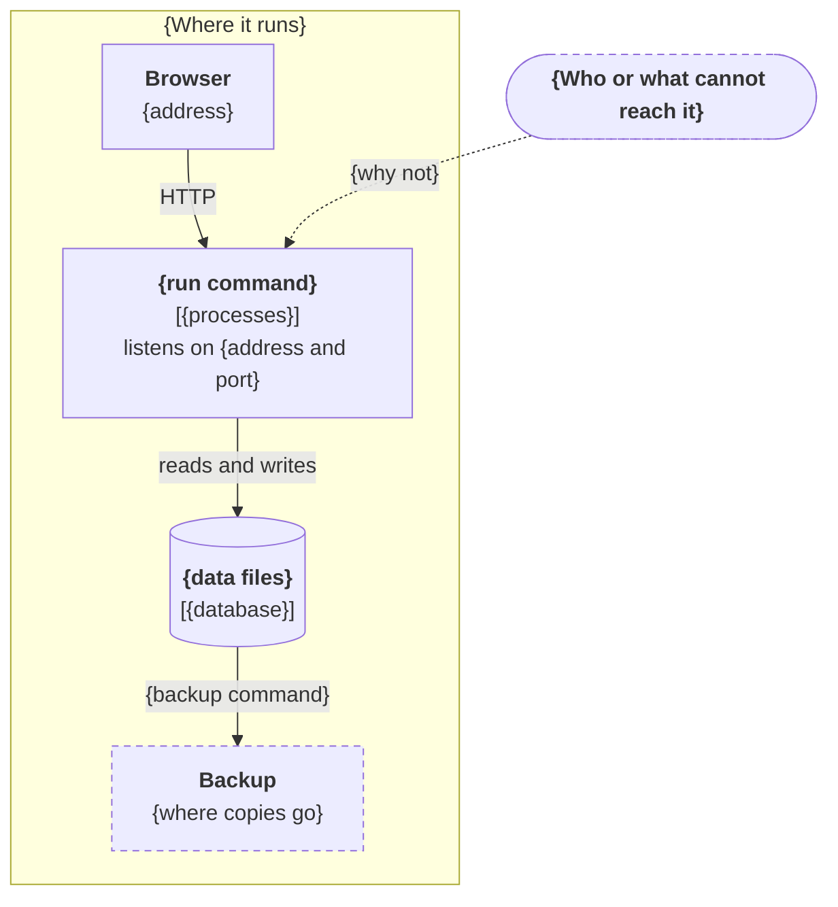

# {App}: design

> **Fill:** copy this file to `docs/design.md` in the project. Replace every `{...}`, delete every "Fill" note, and delete any section marked "when" that does not apply. Rules for each section: `references/design.md` in forge. Worked example: `assets/reference-app-plants/docs/design.md`. Draw it with `python3 scripts/design_page.py docs/design.md docs/design.html --title "{App}: design"`.

**Status:** proposed on {date}. *(After the stop: "accepted by {the user} on {date}" or "accepted unattended on {date}: nobody was available at the architecture stop".)*

**Proposed tier:** {Demo | Repo | Release} (what each tier includes: `references/tiers.md` in forge).

**Files:** this Markdown is the source. `design.html` beside it is the same pack with the diagrams drawn. The code it describes: {paths, or "not written yet"}.

## 1. The decision on one screen

> **Fill:** the stop message, word for word as sent (about 120 words, plain words, the catch included).

> {Only when the recommendation cannot meet a requirement the user stated (confirmed), or one inferred that would change the pick: **First, a conflict:** {the requirement, its tag and source} {and why the recommended option cannot meet it}.}
>
> **Recommended: {A}, {plain name}.** {Why, in at most three lines, tied to the top-ranked attributes.} {The one catch, plainly.}
>
> **{B}, {plain name}:** {good at, costs you, one line}
>
> **{C}, {plain name}:** {one line}
>
> **Tier: {tier}**, because {one line}. Reply **approve**, a letter, or name a change, for example "{a change this user might want}".

**Answer recorded:** {"approve" on {date} | "B" on {date}, see ADR-{n} | none yet}.

Words in **bold** with a short explanation in brackets are defined the first time they appear; section 11 collects them all. {Define the four or five terms every later section uses, for example: A **database** is a program that stores data and enforces rules about it. A **server** is a program that waits for requests and answers them. An **API** (application programming interface) is the fixed set of requests one program can send another, and the answers it can get back.}

## 2. What good means here

### The brief, short

Each fact is tagged: **confirmed** (the user said it), **inferred** (a reading, with the reason) or **preference** (a taste, not a constraint). The tags carry into the requirement ledger below.

- **Who:** {who, on what device, how often}. {Tag each part.}
- **The one job:** {the job}.
- **The hardest judgement:** {what makes the decision hard, what an expert checks first, what goes wrong for newcomers}.
- **Keeps:** {what is kept, how much, for how long}.
- **Conventions:** {language and spelling, time zone, 12 or 24 hour, currency, date form}.
- **Works means:** {one sentence a stranger could check by using it}.

### Quality attributes, ranked for this app

A **quality attribute** (a property of the whole system, such as reliability or privacy, rather than a feature) only helps a decision if it is ranked and made checkable. For this app:

1. **{Attribute}.** {Why it matters most here, in this app's terms.}
2. **{Attribute}.** {Why.}
3. **{Attribute}.** {Why.}
4. **{Attribute}.** {Why it ranks lower; still checked if it is cheap to check.}

Not a goal for this slice: {what is out, and where the full vision is kept}.

### Requirement ledger

Where each requirement came from, before any design is chosen. Priority comes from the brief, never from what an option can deliver.

| Id | Requirement | Tag | Source | Conflicts with |
|---|---|---|---|---|
| {R1} | {Used on the owner's phone} | {confirmed} | {"I check it on my phone in the garden" (brief)} | {Option A: a server on 127.0.0.1 cannot be reached from the phone} |
| {R2} | {Works with no internet} | {inferred} | {"in the garden", where wifi may not reach; not stated} | {none} |
| {P1} | {Light, warm look} | {preference} | {"light and warm" (brief)} | {none} |

Any conflict between a **confirmed** requirement and the recommended option is listed again in section 1, before the recommendation.

### Requirements you could check

A **requirement** here is a sentence a stranger could test by using the app. Status at the stop is "planned"; at the report it becomes **exercised** (a check ran and showed it), **source-supported** (the code appears to do it; nothing ran), **not run** or **not met**.

| Id | Attribute | Requirement | Check | Status |
|---|---|---|---|---|
| R1 | {Reliability} | {A write is shown back from storage after a reload} | {API step and UI reload} | planned |
| R2 | {Reliability} | {A write the server refuses for a rule, with the reason shown} | {API step} | planned |
| R3 | {Reliability} | {Still there after the server restarts} | {API restart step} | planned |
| Q1 | {Privacy} | {No request leaves the computer} | {UI steps with outside requests blocked} | planned |
| Q2 | {Speed} | {`GET /api/{items}` under {N} ms with {M} rows, median of 50, on {machine}} | {timing loop} | planned |
| Q3 | {Reach} | {Opens on {device} at {place}} | {open it there} | planned, or not met (open question {n}) |

The page makes these promises, and no others: {"Saved", "Undo", ...}.

### Structure contract

- **Task, object, device, first action:** {the job; its main object; the device, tagged confirmed, inferred or preference, with source; the first meaningful action}.
- **Analogs:** primary {product, exact screen or state, evidence type: exercised, official demo or marketing still}; supporting {at most two}.
- **Mechanisms reused:** {hierarchy, navigation, action placement, disclosure, density, feedback: what, specifically}.
- **Departures:** {where this product differs from the analog, and why}.

## 3. Options

All options keep the same screens and rules. They differ in {where the data lives, where the rules run, who can reach it}.

> **Fill:** two or three genuine options. Each one a competent engineer would choose for some real brief. Never pad to three.

### Option A: {plain name} (recommended)

**What it is.** {One or two sentences.}

- {How it works, one line.}
- Good at: {...}.
- Costs you: {...}.

### Option B: {plain name}

**What it is.** {...}

- Good at: {...}.
- Costs you: {...}.

### Option C: {plain name}

**What it is.** {...}

- Good at: {...}.
- Costs you: {...}. {Prices: "look up current prices", or prices looked up on {date} with the source.}

### Side by side

| What matters | A: {name} | B: {name} | C: {name} |
|---|---|---|---|
| {Top attribute} ({ids}) | {words, not ticks} | {...} | {...} |
| {Second attribute} ({ids}) | {...} | {...} | {...} |
| {Third attribute} ({ids}) | {...} | {...} | {...} |
| Cost | {...} | {...} | {...} |
| Parts to run | {...} | {...} | {...} |

### The pick, and what would change it

**{A}**, because {tie to the top-ranked attributes; say what it gives up}.

What would change the pick:

- **{A concrete change in the brief}:** {option}, replacing ADR-{n}.
- **{Another}:** {option}.

## 4. The system

### Context



*Look at: {the one thing to notice in this picture, and why it matters}.*

A **system context diagram** (the widest view: the system as one box, the people who use it, and the other systems it talks to) {one or two sentences on what this one shows}. Dashed borders mean "outside the system".

### Containers

> **Fill (when):** two or more running parts. Skip for a single file with no back end.



*Look at: {for example: the page's only arrow goes to the server, so a rule the page skips is still enforced}.*

A **container diagram** (the C4 model's second level: each separately running program or data store inside the system, what it is built with and how they talk) {what this one shows}. "Container" means a running part, not a Docker container.

## 5. Data

> **Fill (when):** there is a schema. Draw it from the real `CREATE TABLE` statements once they exist; until then, from the planned ones.



*Look at: {the one rule the schema itself enforces, and the column that carries it}.*

This is an **entity-relationship diagram** (a picture of the tables, their columns and how rows in one table point to rows in another). PK marks each table's **primary key** (the column that identifies one row), FK a **foreign key** (a column that must hold another table's primary key), UK a column that must be unique.

| Rule | Where it is enforced |
|---|---|
| {A name is 1 to N characters} | {`CHECK`, and the validator first so the page gets a reason per field} |
| {No duplicates of X} | {`UNIQUE`; a clash becomes 409 `{code}`} |
| {Every Y belongs to a real X} | {foreign key, with `PRAGMA foreign_keys = ON` on every connection} |

How the schema changes: {numbered migrations, how the version is recorded}. What is kept, why, and for how long: {fields, purpose, retention, how a person removes their data}.

## 6. The main action and how it fails

### {The main action}



*Look at: step {n}. {Why that step is the one that matters.}*

A **sequence diagram** (who sends what to whom, in time order, top to bottom) {one or two sentences}. A **transaction** (a group of database changes that all happen or none do) {what it protects here}.

### When it fails



*Look at: {for example: no branch sends the change twice}.*

### {A retry after a lost answer}

> **Fill (when):** a create can be retried.



*Look at: {for example: the second request changes nothing}.*

### The contract, in brief

| Request | Success | Refusals and errors |
|---|---|---|
| `GET /api/{items}?limit=&after=` | 200: up to `limit` items and a cursor | 422 bad limit or cursor |
| `POST /api/{items}` | 201: the item | 409 `{code}`, 422 `invalid` with a reason per field, 415, 413, 400 |

Every error has one shape: {the shape}. {Fields the server owns, and how they are refused.}

## 7. {Thing}'s lifecycle

> **Fill (when):** anything with a status, an undo, an approval, a booking or an order.



*Look at: {for example: there is no arrow out of paid except the end}.*

A **state diagram** (the states something can be in and the events that move it between them) {say whether the status is stored or worked out on each read}.

## 8. Where it runs



*Look at: {the arrow or the gap that matters}.*

What it needs: {runtime and version, database and version, anything platform-specific}.

```
{run command}
{backup command}
{restore command}
```

{What restore replaces, what it refuses, whether it has been run, and the result.} {Who can reach it and why: address, Host check, sign-in.}

## 9. Decisions

Each record: the decision, the situation that forced it, the options, and what follows. An **ADR** (architecture decision record) is kept after it is replaced, marked as replaced, so the reasons are not lost.

### ADR-1: {Decision as a short sentence}

- **Decision:** {...}
- **Context:** {...}
- **Options:** {chosen one first}; {...}; {...}.
- **Consequences:** {good and bad, including what it makes harder later}.

> **Why this, not that.** {The tempting alternative, stated fairly. What goes wrong with it here, concretely, with a number from a check if there is one. When it would be the right call.} **Think about it:** {one question} *or* **Try this:** {one ten-minute exercise that was run, or say the result is not yet checked}.

### ADR-2: {...}

- **Decision:** {...}
- **Context:** {...}
- **Options:** {...}
- **Consequences:** {...}

> **Why this, not that.** {...}

## 10. Mistakes to watch for

Two or three per layer this build has: the mistake, how this design avoids it, how you would notice.

### Design

- **{Mistake}.** {How this design avoids it.} {How you would notice.}

### Page

- **{Mistake}.** {...}

### API

- **{Mistake}.** {...}

### Rules and storage

- **{Mistake}.** {...}

### Time and money

- **{Mistake}.** {...}

### Running it

- **{Mistake}.** {...}

## 11. Glossary

| Term | Meaning |
|---|---|
| {Term} | {The same one-line definition used at its first appearance} |

## 12. Open questions

1. **{Question}.** {Why it is open, the choices, and what each would change.}
