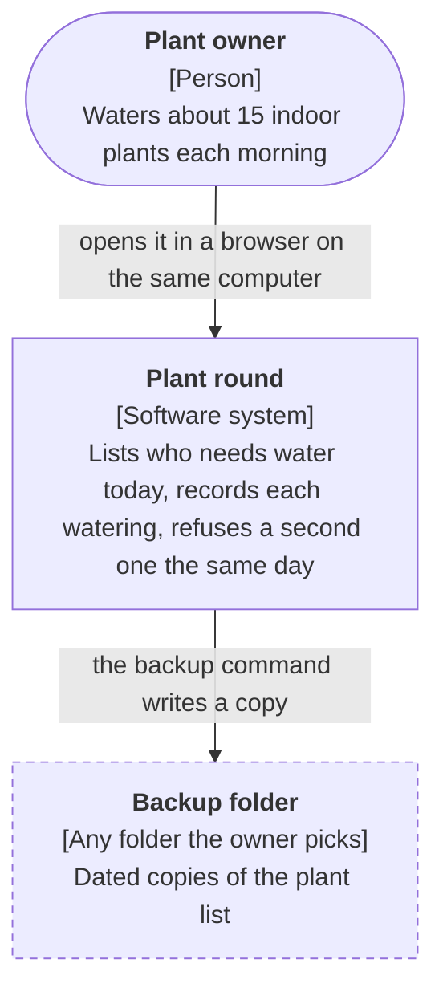
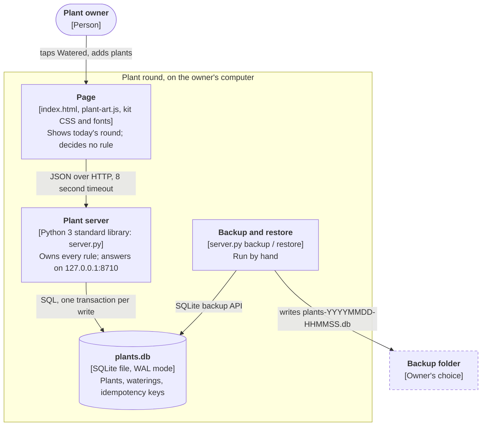
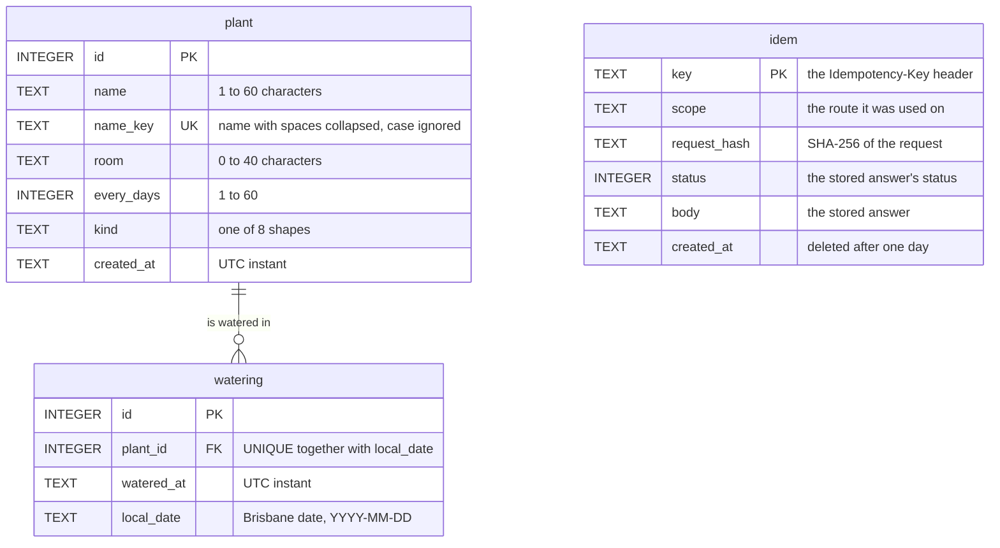
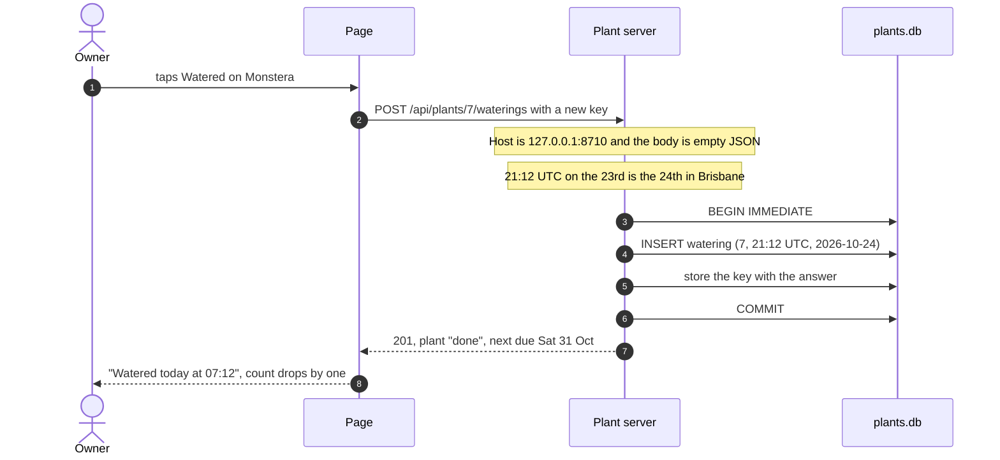
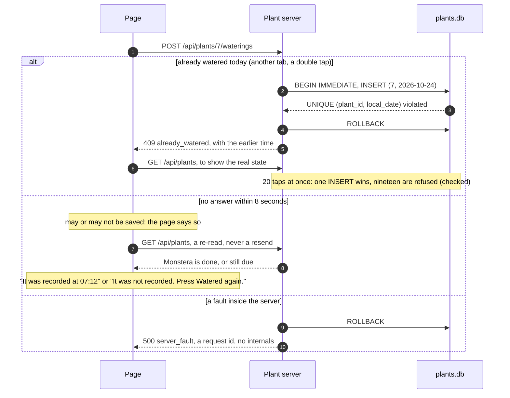
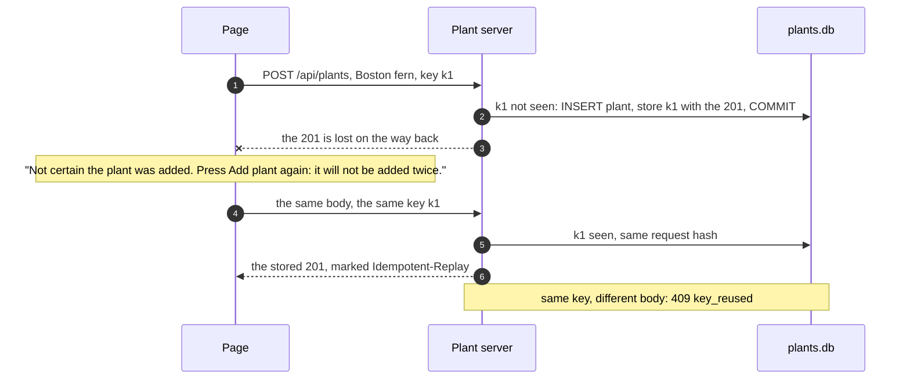
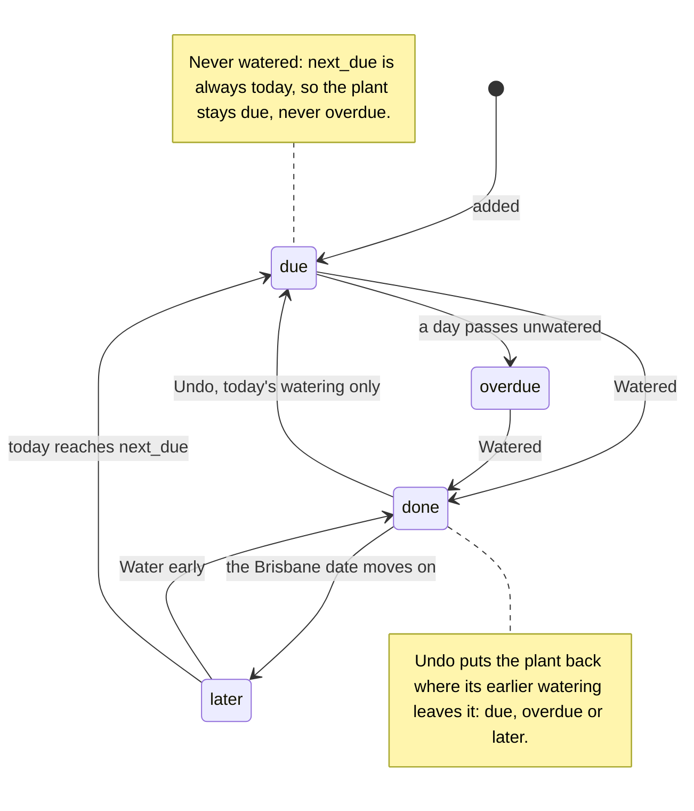
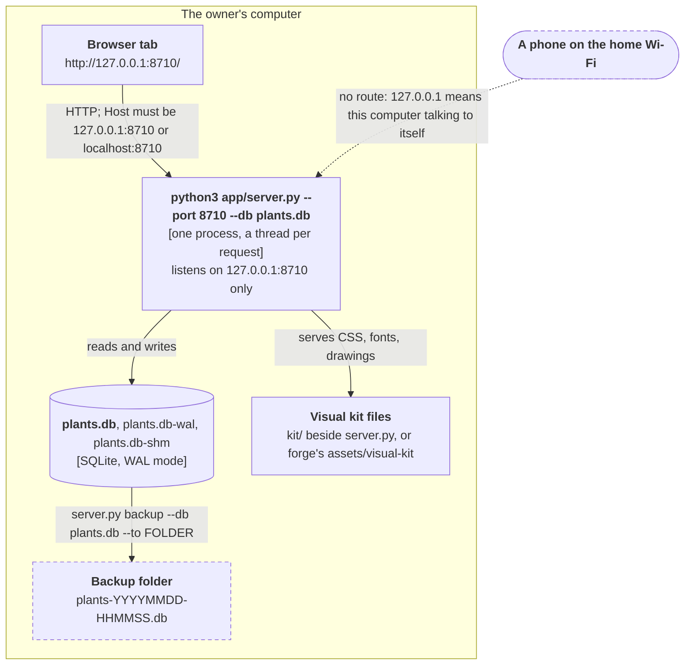

# Plant round: design

**Status:** built and checked. Forge 3.1 built this app on 23 Oct 2026 with nobody to ask, and forge 3.1 had no architecture stop. Its screens were restyled under forge 3.2. This pack was written afterwards, from the code, as the worked example of the stop forge 3.2 adds, and its requirement tags and ranking were corrected under forge 3.3. At a real stop the pack comes before any code: the schema and routes are a plan, and every check says "planned".

**Proposed tier:** Repo (what each tier includes: `references/tiers.md` in forge).

**Files:** this Markdown is the source. `design.html` beside it is the same pack with the diagrams drawn, made by forge's `scripts/design_page.py`. The code it describes: `../app/server.py` and `../app/index.html`.

## 1. The decision on one screen

This is what the stop message would have shown.

> **First, one thing to check: I assumed you use this on your phone** (you didn't say; it is how a morning watering round usually works). The design I recommend cannot open on a phone as it stands. If phone use is real, tell me, and see open question 1.
>
> **Recommended: A, one local server with SQLite (a database in a single file) on your computer.** Your plants and waterings stay in one file on your own machine. The server, not the page, enforces "one watering per plant per day", so a double tap or a second tab can never record two. It costs nothing to run. The catch: as designed it opens only on the computer that runs it, not on your phone (open question 1).
>
> **B, one page that saves in the browser:** simplest and works on a phone, but the data lives in one browser and the daily rule lives in page code that a second tab can race.
>
> **C, a server on the internet with a provider-run database:** opens anywhere and could be shared, but needs a login, a monthly bill and your data on someone else's server.
>
> **Tier: Repo.** Reply **approve**, **B** or **C**, or name a change, for example "approve, but it must open on my phone".

**Answer recorded:** none. The build ran unattended, so it went ahead with A. A person reading this now can still pick B or C, or ask for phone access; section 3 says what each would change.

Words in **bold** with a short explanation in brackets are defined the first time they appear; section 11 collects them all. Four come up straight away. A **database** is a program that stores data and enforces rules about it. **SQLite** is a database that lives in a single file, with no separate server to run. A **server** is a program that waits for requests and answers them. An **API** (application programming interface) is the fixed set of requests one program can send another, and the answers it can get back: here, what the page may ask the plant server.

## 2. What good means here

### The brief, short

- **Who:** one person with about 15 indoor plants, every morning, on a phone, with a laptop now and then. The person, the phone and the laptop are all inferences: nobody was asked (requirement ledger below).
- **The one job:** see which plants need water today, tick them off, see when each was last watered.
- **The hardest judgement:** "does this one really need it today?" Plants range from every 3 days to every 14. An expert checks the last watering date against the plant's own interval. Newcomers overwater the slow ones, forget the thirsty ones, and two people can water the same plant twice.
- **Keeps:** about 15 plants and every watering, with no end date.
- **Conventions:** Australian English, 24-hour clock, Australia/Brisbane time (no daylight saving), dates written "Tue 2 Mar".
- **Works means:** add a plant that needs water every 3 days, tick it, reload the next morning and see "watered yesterday, due again in 2 days".

### Quality attributes, ranked for this app

A **quality attribute** (a property of the whole system, such as reliability or privacy, rather than a feature) only helps a decision if it is ranked and made checkable. For this app:

1. **Reliability of the record.** The round is only useful if "watered today" is true. A double record, a lost watering or a wrong date breaks the one job.
2. **Privacy.** A list of what someone keeps at home and when they are there to water it is nobody else's business.
3. **Reach (inferred).** A round done standing by the plants is done on a phone. If that inference is right, reach matters nearly as much as reliability: a round you cannot open where the plants are does not get used. It ranks third, not first, only because nobody confirmed the phone. It does not rank lower because the recommended design cannot provide it; that would be reasoning backwards from the build. The conflict is shown first in the stop message and stays open as question 1.
4. **Low cost and little to run.** It is a personal tool. Anything with a monthly bill or an account to manage needs a strong reason.
5. **Speed.** With 15 plants almost any design is fast enough. It still gets a number, so "fast" means something.

Not a goal for this slice: two people sharing one list, reminders, editing or removing plants, photos. They are in the full vision in `../notes.txt`.

### Requirement ledger

| Requirement | Tag | Source | Conflicts with |
|---|---|---|---|
| Daily use, one person, about 15 plants | inferred | The example's own brief; nobody was asked | none |
| Used on a phone, laptop now and then | inferred | "each morning" by the plants; not stated | Option A: a server on 127.0.0.1 cannot be reached from a phone (open question 1) |
| Kept indefinitely | inferred | A watering history is only useful if it lasts | none |
| One watering per plant per local day | inferred | From the job: a second tick on the same day would make "watered today" untrue | none |
| Australian English, Brisbane time, 24-hour clock | preference | The example's brief | none |

### Requirements you could check

A **requirement** here is a sentence a stranger could test by using the app. The ids starting R match `../notes.txt`; Q ids are the quality attributes above. Status words: **exercised** (a check ran and showed it), **source-supported** (the code appears to do it; nothing ran), **not met**.

| Id | Attribute | Requirement | Check | Status |
|---|---|---|---|---|
| R2 | Reliability | Ticking a plant shows the time it was watered and its next due date, both from the server | API step "water Boston fern"; UI steps | exercised, rerun 23 Oct 2026 (API) |
| R3 | Reliability | A second watering of the same plant on the same Brisbane day is refused, and the row says when the first one happened | API step "second watering the same day refused" | exercised, rerun 23 Oct 2026 |
| R6 | Reliability | Plants and waterings are still there after the server restarts | API restart step; UI reload | exercised, rerun 23 Oct 2026 (API) |
| R7 | Reliability | 20 ticks of one plant at the same moment record exactly one watering: one 201 and nineteen 409 answers (an **HTTP status code** is the number at the start of every answer: 201 means created, 409 means refused because of what is already stored) | API step "20 ticks of one plant at once" | exercised, rerun 23 Oct 2026 |
| R9 | Reliability | "Today" is Brisbane's date, worked out by the server: 13:59:59 **UTC** (the world's reference clock; Brisbane is always 10 hours ahead of it) is still the 23rd in Brisbane, 14:00:00 UTC is the 24th | clock steps a and b | exercised, rerun 23 Oct 2026 |
| R12 | Reliability | Sending the same "add plant" twice with the same **idempotency key** (a random id the page attaches to one intended change; section 6) adds one plant, even across a restart | API steps | exercised, rerun 23 Oct 2026 |
| R13 | Reliability | A backup can be restored | `server.py backup`, then `restore` into a new file: 15 plants and 15 waterings in, the same out | exercised 23 Oct 2026, sample data |
| Q1 | Privacy | The page makes no request to anything outside the computer | UI steps run with outside requests blocked | exercised (README record) |
| Q2 | Privacy | Only the owner's own browser can use the server: a request naming another site in its `Host` header gets 403, a write that is not JSON gets 415, and no headers invite other websites to read the answers (ADR-5) | API steps (R10 in the notes) | exercised, rerun 23 Oct 2026 |
| Q3 | Cost | Nothing to pay and no account: Python's standard library and SQLite only | the component ledger in `../notes.txt` | source-supported |
| Q4 | Speed | `GET /api/plants` answers in under 100 ms with 200 plants | timed 50 times on the build machine: median 3.6 ms with 200 plants and 1,815 waterings, 1.5 ms with 15 plants | exercised on the build machine only, not the owner's computer |
| Q5 | Offline | Works with the internet switched off | UI steps run with outside requests blocked | exercised (README record) |
| Q6 | Reach | Opens on the owner's phone each morning | none possible: the server answers only on 127.0.0.1, the computer's address for itself (section 8) | not met (open question 1) |

The page makes two promises, "Watered" (R2) and "Undo" (R8, today's watering only), and no others: no "Saved", "Synced" or "Works offline" labels.

## 3. Options

All three keep the same screens and the same rules. They differ in the three decisions that are expensive to change later: where the data lives, where the rules run, and who can reach it.

### Option A: one local server with SQLite (recommended)

**What it is.** A Python program on the owner's computer serves the page and a small API. Everything is kept in one SQLite file.

- The page asks; the server decides. Every rule (valid plant, unique name, once a day, what "today" is) lives on the server or in the database.
- The rules that matter most are written into the **schema** (the description of the tables, their columns and the rules on them) as **constraints** (rules the database itself enforces on every write, whatever code sends it), so no code path can break them.
- Good at: the daily rule holds under double taps; data never leaves the machine; no cost; survives restarts; one file to back up.
- Costs you: the computer must be on and the server started; as designed only that computer can open it; backups happen only when someone runs the command.

### Option B: one HTML page that saves in the browser

**What it is.** A single file with no server. The page keeps plants and waterings in **IndexedDB** (a small database built into every browser, private to one site in one browser).

- Good at: nothing to install or start; can live on the phone; works without a network; no cost.
- Costs you: the data lives in one browser on one device, and clearing site data or changing phones loses it unless it was exported. The once-a-day rule is page code: two tabs can both read "not watered yet" before either writes, a **race condition** (two operations overlapping in time, so the result depends on which finishes first). "Today" comes from the device's clock. Inside a chat preview frame, browser storage can be blocked entirely.

### Option C: a hosted API with a managed database

**What it is.** The same API running on a hosting service on the internet, with a database run by a provider (managed PostgreSQL, for example).

- Good at: opens on phone and laptop from anywhere; two people could share one list; the provider backs up the database.
- Costs you: a public address means a login and per-person rules, which is more code and more to get wrong. A monthly bill (look up current prices when deciding; free tiers change and some pause idle apps). Deploying needs credentials and your go-ahead. Your plant list sits with a third party. No internet, no round.

### Side by side

| What matters | A: local server + SQLite | B: page + browser storage | C: hosted API + managed database |
|---|---|---|---|
| Once a day per plant, even with two taps (R3, R7) | Database constraint | Page code only; a second tab can race it | Database constraint |
| Record survives (R6, R13) | File on disk plus a backup command | Until browser data is cleared | Provider's backups |
| Privacy (Q1, Q2) | Never leaves the computer | Never leaves the device | Held by a third party, behind a login |
| Phone (Q6) | No, as designed | Yes | Yes |
| Cost (Q3) | Nothing | Nothing | Monthly; look up current prices |
| No internet needed (Q5) | Yes | Yes | No |
| Parts to run | One process, one file | One file | Host, database, login, deploys |

### The pick, and what would change it

**A**, because the three attributes ranked highest (reliability, privacy, cost) all point to it, and the hardest rule is enforced by the database rather than by page code. B gives up reliability for convenience. C buys reach with a login, a bill and someone else holding the data, for one person at home.

What would change the pick:

- **The phone must open it, at home only:** stay with A, but listen on the home network and add a login. That replaces **ADR-5** (an architecture decision record: section 9 has one per expensive decision); it is a new decision, not a setting.
- **The phone must open it away from home, or two people share the list:** C.
- **No computer stays on, and losing the history would be a shrug:** B, with an export button.
- **Hundreds of plants:** still A. Measured at 200 plants, a read takes 3.6 ms here.

## 4. The system

### Context



*Look at: nothing points to the internet. The round talks to no outside service, which is where its privacy and its zero running cost come from.*

A **system context diagram** (the widest view: the system as one box, the people who use it, and the other systems it talks to) answers "what is this, and what does it touch?" before anyone looks inside. Dashed borders mean "outside the system".

### Containers



*Look at: the page has one arrow, and it goes to the server. The page never touches the database, so a rule the page skips is still enforced.*

A **container diagram** (the C4 model's second level: each separately running program or data store inside the system, what it is built with and how they talk) is the one to read before the code. "Container" here means a running part, not a Docker container. The **C4 model** (a way of drawing software at four zoom levels: context, containers, components, code) is the convention these two diagrams follow; forge draws them as Mermaid flowcharts because Mermaid's own C4 syntax lays out poorly.

The page talks to the server in **JSON** (a plain-text format for structured data) over **HTTP** (the request-and-answer protocol every browser speaks), and the server talks to the database in **SQL** (the language for asking a database to read or change data). The server also serves the page's own files (`/`, `/plant-art.js`, the kit's CSS, fonts and drawings), so the page and the API share one address. That matters for ADR-5.

## 5. Data



*Look at: `watering` keeps both `watered_at` (the moment) and `local_date` (the Brisbane day). The once-a-day rule is on the day, and the day never has to be recalculated.*

This is an **entity-relationship diagram** (a picture of the tables, their columns and how rows in one table point to rows in another). It is drawn from the three `CREATE TABLE` statements in `MIGRATIONS` in `server.py`. PK marks each table's **primary key** (the column that identifies one row); FK marks a **foreign key** (a column that must hold another table's primary key: here, every watering belongs to a real plant); UK marks a column that must be unique.

Every rule below is a constraint, so the database refuses a bad write even if the code has a bug:

| Rule | Where it is enforced |
|---|---|
| A name is 1 to 60 characters, a room at most 40, an interval 1 to 60 days, the shape one of eight | `CHECK` constraints, and `validate_plant` first, so the page gets a reason per field |
| No two plants share a name, ignoring case and extra spaces | `name_key TEXT NOT NULL UNIQUE`; a clash becomes 409 `duplicate_name` |
| One watering per plant per Brisbane day | `UNIQUE (plant_id, local_date)`; a clash becomes 409 `already_watered` |
| A watering belongs to a plant that exists | `REFERENCES plant(id) ON DELETE CASCADE`, with `PRAGMA foreign_keys = ON` on every connection (SQLite leaves it off otherwise) |
| `local_date` looks like a date | `CHECK (local_date GLOB '[0-9][0-9][0-9][0-9]-[0-9][0-9]-[0-9][0-9]')` |
| A text value never lands in a number column | `STRICT` tables |

How the schema changes: through the list of **migrations** (numbered, scripted changes to the schema, applied once, in order, and never edited afterwards) in `server.py`. The database records how many have run in `PRAGMA user_version`, now 3. Each step runs in its own **transaction** (a group of database changes that all happen or none do) together with its version number, so a failed step leaves nothing half-done.

What is kept, and for how long (from the comment beside the schema): plant name, room, interval and shape, and the time of each watering, for the watering round, until the owner removes it. There is no remove flow yet (open question 2). Idempotency keys are deleted after a day.

The `UNIQUE (plant_id, local_date)` constraint also gives SQLite an index, and the query that finds each plant's latest watering uses it (checked with `EXPLAIN QUERY PLAN`).

## 6. The main action and how it fails

### Ticking "Watered"



*Look at: step 4. The date that decides "once a day" comes from the server's clock in Brisbane, never from the phone or laptop.*

A **sequence diagram** (who sends what to whom, in time order, top to bottom) is the best way to check a design against its hardest moment. One transaction wraps the insert and the stored answer, so a failure halfway leaves no trace. `BEGIN IMMEDIATE` takes the database's write lock at the start, so two writers queue rather than interleave.

### When it fails



*Look at: no branch sends the watering twice. A refusal is shown with the earlier time, and an unknown outcome is checked by reading, not guessed.*

A race condition is the classic way a "once a day" rule breaks: both requests check, both see "not yet", both write. The constraint closes it, because the database checks and writes as one step. The check in `../checks/api-steps.json` fires 20 requests at once and expects one 201 and nineteen 409s.

### Adding a plant when the answer is lost



*Look at: the second request changes nothing in the database. The key turns "press it again" from a gamble into a safe instruction.*

**Idempotency** (an operation is idempotent when doing it twice has the same effect as doing it once) is what makes a retry safe. The idempotency key gives a create that property: the server recognises the repeat and replays its first answer. The page keeps the same key for as long as the form holds the same values.

### The contract, in brief

| Request | Success | Refusals and errors |
|---|---|---|
| `GET /api/health` | 200 `{status}` | |
| `GET /api/today` | 200: Brisbane date, counts, the next seven days | |
| `GET /api/plants?limit=&after=` | 200: up to `limit` plants (1 to 200, default 100), then a cursor in `next` | 422 bad limit or cursor |
| `POST /api/plants` | 201: the plant | 409 `duplicate_name`, 409 `key_reused`, 422 `invalid` with a reason per field, 415, 413, 400 |
| `POST /api/plants/{id}/waterings` | 201: the watering and the plant | 409 `already_watered`, 404, 422 if the body has any field, 415 |
| `DELETE /api/waterings/{id}` | 200: the plant | 409 `too_old` (only today's can be undone), 404 |

Every error has the same shape, `{"error": {"code", "message", "fields", "request_id"}}`, and every answer carries `X-Request-Id`. A busy or unreadable database answers 503 `storage_busy`, "Nothing was changed. Try again." Fields the server owns (`id`, `next_due`, `status` and others) are refused with "is set by the server". Lists use a **cursor** (a marker for "carry on after this row", here the last row's due date, name and id) rather than page numbers, so a plant added mid-scroll is neither skipped nor shown twice.

## 7. A plant's status over time



*Look at: no arrow is a job that runs at midnight. Status is worked out on every read from the latest watering, the interval and Brisbane's date, so it cannot go stale.*

A **state diagram** (the states something can be in and the events that move it between them) is worth drawing for anything with a lifecycle. Two details live in the notes rather than as arrows, to keep the picture readable. A plant watered every day goes from done straight back to due the next morning, never through later. And Undo does not always return a plant to due: if its previous watering makes it overdue or not yet due, that is where it goes.

## 8. Where it runs



*Look at: the dotted arrow. It is the gap between the brief (a phone) and this design (one computer), drawn where you cannot miss it.*

What it needs: Python 3.9 or later. Where the platform has no time-zone data (Windows without the `tzdata` package), the server uses a fixed +10:00, which is right for Brisbane because Queensland has no daylight saving. SQLite 3.37 or later, for `STRICT` tables; check with `python3 -c "import sqlite3; print(sqlite3.sqlite_version)"` (3.45.1 on the build machine).

How to run it, back it up and restore it:

```
python3 app/server.py --port 8710 --db plants.db
python3 app/server.py backup --db plants.db --to FOLDER
python3 app/server.py restore --db plants.db --from FILE --replace
```

The restore command replaces every plant and watering in `plants.db`. It refuses without `--replace`, refuses a file that is not a plants database or has a schema version it does not know, and does not check whether the server is running, so stop the server first. Run on 23 Oct 2026 on sample data: without `--replace` it refused (exit 2); with it, 15 plants and 15 waterings went in and the same came out, schema version 3; a file that was not a database was refused.

**localhost** (the name a computer uses for itself; `127.0.0.1` is its address) is the only place the server listens. Two test switches exist and are refused unless given: `--now 2026-10-24T06:30+10:00` freezes the clock (the page shows a banner) and `--faults` adds a route that fails on purpose, for the 500 check.

## 9. Decisions

Each record is short: the decision, the situation that forced it, the options, and what follows from it. An **ADR** (architecture decision record) is kept even after the decision changes, marked as replaced, so the reasons are not lost. All eight below were accepted unattended on 23 Oct 2026.

### ADR-1: One local server with SQLite

- **Decision:** run the round as one Python program on the owner's computer that serves the page and the API and keeps everything in one SQLite file.
- **Context:** one person, about 15 plants, records kept with no end date; reliability, privacy and cost ranked highest; the daily rule must hold under double taps.
- **Options:** A (chosen); B, a page with browser storage; C, a hosted API with a managed database (section 3).
- **Consequences:** the database enforces the rules; data stays on one machine; the computer must be on and the server started; the phone cannot open it as designed (open question 1); backups are the owner's job (ADR-7).

> **Why this, not that.** A single page with browser storage looks simpler, and for a throwaway tool it is. But the daily rule would live in page code, and two tabs can both read "not watered yet" before either writes. A database constraint cannot be raced that way. A hosted service would solve the phone problem, at the price of a login, a bill and someone else holding the data, all to serve one person at home. **Try this:** open the database with `sqlite3 plants.db` and type `.schema`. Every rule in section 5 is there in plain text.

### ADR-2: The server works out "today", in Australia/Brisbane

- **Decision:** every date the round stores or shows (today, `local_date`, `next_due`) comes from the server's clock converted to Australia/Brisbane. The page never works out a date.
- **Context:** watering happens around 7 am; Brisbane is UTC+10 all year.
- **Options:** the server computes in a fixed zone (chosen); the browser computes from its own clock and zone; store only UTC and convert when showing.
- **Consequences:** every tab and device agrees; times carry "Brisbane time" when the viewer's zone differs; `--now` can freeze the clock for tests, with a banner; with no zone data the server falls back to +10:00.

> **Why this, not that.** The tempting line in the page is `new Date().toISOString().slice(0, 10)`. It gives the date in UTC, which in Brisbane is still yesterday until 10 am, exactly when the watering happens. The browser's own zone is wrong too if the laptop is set to Sydney, an hour ahead in summer. With the rule on the server there is one clock and one zone to test, and the checks prove the boundary. **Think about it:** what would have to change if the owner moved to Sydney, which has daylight saving?

### ADR-3: "Once per plant per day" is a UNIQUE constraint

- **Decision:** `watering` has `UNIQUE (plant_id, local_date)`; the insert runs inside `BEGIN IMMEDIATE`; a violation becomes 409 `already_watered`, quoting the earlier time and the next due date.
- **Context:** double taps and second tabs; the brief notes that two people can water the same plant twice.
- **Options:** a constraint (chosen); look for today's watering in code, then insert; `INSERT OR IGNORE`.
- **Consequences:** no write path can break the rule, scripts included; the refusal reaches the owner in words; 20 simultaneous ticks give one 201 and nineteen 409s; the constraint's index also speeds up the latest-watering lookup.

> **Why this, not that.** "Check, then insert" reads well: look for today's watering, and if there is none, add one. But between the check and the insert another request can make the same check, and both insert. `INSERT OR IGNORE` closes that gap but swallows the refusal, so the owner never hears "already watered at 07:12". **Try this:** in a copy of the app, delete the `UNIQUE (plant_id, local_date)` line from the migration, start with a fresh database and run the API checks. When this pack was written, that change made 9 of the 54 steps fail, the 20-tick race among them. Then put the line back.

### ADR-4: Idempotency keys on creates

- **Decision:** both creates honour an `Idempotency-Key` header. The key, the route, a hash of the request and the answer are stored in `idem` in the same transaction as the create. The same key with the same request replays the stored answer; with a different request it is refused (409 `key_reused`). Keys are deleted after a day.
- **Context:** a laptop waking from sleep or a patchy connection can lose an answer after the server has saved the change.
- **Options:** keys (chosen); no keys, never retry; retry blindly.
- **Consequences:** the add form can truthfully say "Press Add plant again: it will not be added twice"; keys survive a restart (checked); one more table. The Watered button never resends at all: it re-reads instead.

> **Why this, not that.** When a request gets no answer there are two possible worlds: it never arrived, or it was saved and the reply was lost. The page cannot tell which. Retrying blindly doubles the change in the second world; never retrying leaves the owner stuck. **Think about it:** names are already unique, so a retried "add" without a key could not create a second Boston fern. What would the owner see instead, and why would it confuse them?

### ADR-5: Reachable only from the same computer, with no login

- **Decision:** listen on 127.0.0.1 only; refuse any `Host` header other than `127.0.0.1:PORT` or `localhost:PORT` (403 `bad_host`); require `Content-Type: application/json` on writes (415 otherwise); send no CORS headers; no login.
- **Context:** one person on one machine, and any website the owner visits can make their browser send requests to localhost.
- **Options:** same computer only (chosen); listen on the home network with no login; home network with a login.
- **Consequences:** no passwords to manage; a hostile web page cannot add or tick plants (checked: foreign `Host` refused, `text/plain` refused, no CORS header); the phone cannot reach it.

> **Why this, not that.** "It only runs on my laptop" feels safe, but the browser is a bridge: any site you visit can make it send a request to 127.0.0.1, and a trick called **DNS rebinding** (a hostile site pointing its own name at your computer's address, so the browser treats your local server as part of that site) can even read the answers. The `Host` check stops rebinding, and the JSON-only rule stops the simple cross-site form post. **CORS** (cross-origin resource sharing: headers by which a server tells the browser which other websites may read its answers) is left off, so no other site may read them. Changing `127.0.0.1` to `0.0.0.0` so the phone works is a one-line change AI tools often suggest; it puts a server with no login on every device on the Wi-Fi.

### ADR-6: Status is worked out on every read, never stored

- **Decision:** due, overdue, done and later are computed each time from the latest watering, `every_days` and Brisbane's date. There is no status column and no midnight job.
- **Context:** status changes when the date changes, with nobody touching the data.
- **Options:** derive it (chosen); store a status column and update it on a schedule.
- **Consequences:** status cannot drift from the waterings; there is no scheduled job to fail; a client that sends a status is refused (422 "is set by the server"); every read does a little arithmetic (3.6 ms median for 200 plants on the build machine).

> **Why this, not that.** A stored status looks tidy until the morning it is wrong because the server was off at midnight and the update never ran. A **derived value** (one you can compute from data you already store) kept in its own column becomes a second source of truth that can disagree with the first. Store what happened (a watering at 07:12); compute what it means (due again on Saturday).

### ADR-7: Backups through SQLite's backup API, with a guarded restore

- **Decision:** `backup` writes a dated copy through SQLite's backup API; `restore` refuses without `--replace`, refuses a file that is not a plants database or has an unknown schema version, then copies it in and runs the migrations.
- **Context:** the round holds the only record of every watering, and disks fail.
- **Options:** the backup API (chosen); copying the `.db` file; no backups.
- **Consequences:** a consistent copy even while the server runs; restore has been run once (section 8); backups exist only if the owner runs the command; restore does not stop a running server for you.

> **Why this, not that.** In **WAL** mode (write-ahead logging: SQLite writes new changes to a side file, `plants.db-wal`, and folds them into the main file later), recent changes may not be in `plants.db` yet. Copying that file alone while the server runs can miss them. The backup API asks SQLite itself for a consistent copy. And a backup that has never been restored is a hope, not a backup. **Try this:** back up, restore into a new file name with `--db test.db`, and count the plants in both.

### ADR-8: Python's standard library, no web framework

- **Decision:** `http.server`, `sqlite3` and `zoneinfo` only, in one file of about 620 lines.
- **Context:** six API routes plus the page's files; a reference build that must run wherever Python 3 does, with every line readable.
- **Options:** the standard library (chosen); Flask or FastAPI; Node.
- **Consequences:** nothing to install; routing, JSON parsing and the error handler are written by hand; the ledger's trigger for a framework is about 20 routes.

> **Why this, not that.** A framework gives routing and validation for free, and a bigger app should use one. Here the hand-written HTTP layer is small, and being able to read how a request becomes an answer is part of the point. The opposite mistake is just as real: layers with fancy names (repositories, factories) that have one implementation and no test that swaps it.

## 10. Mistakes to watch for

Two or three per layer: what beginners and AI tools commonly get wrong here, how this design avoids it, and how you would notice.

### Design

- **Boxes with nothing behind them.** A diagram shows a cache, a queue or an auth service the code never has. Here every box is in the component ledger with the flow that needs it; anything else is listed under "add when". You would notice when a box has no file or process you can point to.
- **Options set up to lose.** A pack offers a "microservices" option nobody would choose, to make the pick look wise. Each option in section 3 is one a competent engineer would choose for some brief, and the "what would change the pick" list says which brief.
- **A design that drifts from the code.** The pack is checked against the code before the final report: the ER diagram against the `CREATE TABLE` statements, the contract table against the routes.

### Page

- **Working out "today" in the browser.** Covered in ADR-2. Notice it by setting the laptop to another zone, or by reading any `toISOString().slice(0, 10)`.
- **Treating "no answer" as "failed" and sending again.** The page re-reads instead, and says "not certain" while it checks. Notice it by blocking the network in the browser's developer tools mid-tap.
- **Putting user text into the page as HTML.** A plant called `` would run code. The page sets text with `textContent`; only the drawings from `plant-art.js` go in as markup.

### API

- **Silent coercion.** Accepting `"7"`, `true` or `3.5` as a number of days. `validate_plant` refuses all three, and the checks send each one.
- **Letting the client set fields the server owns.** A request that sets `next_due` or `status` is refused with 422 and the field named, never quietly applied.
- **A different error shape on every route.** Here there is one shape, with a `message` written for the owner ("Boston fern was already watered today at 07:12") and a `code` written for programs.

### Rules and storage

- **Check, then write.** The race in ADR-3. The constraint makes it impossible; the 20-tick check proves it.
- **Foreign keys switched off.** SQLite ignores `REFERENCES` unless `PRAGMA foreign_keys = ON` is set on each connection. `connect()` sets it every time.
- **Changing the schema by hand.** Editing `CREATE TABLE` in place, or using `CREATE TABLE IF NOT EXISTS`, leaves existing databases on the old shape. Here every change is a numbered migration recorded in `PRAGMA user_version`.

### Time

- **Keeping only the moment, or only the day.** This design keeps both: `watered_at` in UTC for "when exactly", and `local_date` for the daily rule.
- **Showing a date-only value in the viewer's time zone.** `2026-10-24` shown through a Los Angeles laptop's zone can come out as the 23rd. The page formats date-only values in UTC, so the day never shifts.
- **Assuming time-zone data exists.** Python on Windows has none unless `tzdata` is installed. The fallback here is a fixed +10:00, valid only because Brisbane has no daylight saving.

### Running it

- **Opening the server to the network to reach the phone.** See ADR-5: that needs a login and is a new decision.
- **Copying the database file as a backup while the server runs.** See ADR-7: use the backup command.
- **Never trying a restore.** It was run once for this pack. Do it again after any schema change.

## 11. Glossary

| Term | Meaning |
|---|---|
| ADR | Architecture decision record: a short note of one decision, its context, the options and the consequences, kept even after it is replaced |
| API | Application programming interface: the fixed set of requests one program (here the page) can send another (the server), and the answers it can get back |
| C4 model | A way of drawing software at four zoom levels: context, containers, components, code |
| Constraint | A rule written into the schema that the database enforces on every write, such as `UNIQUE`, `CHECK`, `NOT NULL` or a foreign key |
| Container diagram | The C4 model's second level: each separately running program or data store, what it is built with and how they talk. Not about Docker |
| CORS | Cross-origin resource sharing: headers by which a server tells the browser which other websites may read its answers |
| Cursor | A marker meaning "carry on after this row", used to page through a list without skipping or repeating rows |
| Database | A program that stores data and enforces rules about it |
| Derived value | A value that can be computed from data already stored, such as a plant's status |
| DNS rebinding | A hostile website pointing its own name at your computer's address, so the browser treats your local server as part of that site |
| Entity-relationship diagram | A picture of the tables, their columns and how rows in one table point to rows in another |
| Foreign key | A column that must hold the primary key of a row in another table |
| HTTP | The request-and-answer protocol every browser speaks |
| HTTP status code | The number at the start of every answer: 2xx worked, 4xx the request was refused, 5xx the server failed |
| Idempotency | Doing an operation twice has the same effect as doing it once |
| Idempotency key | A random id sent with one intended change, so the server can recognise a repeat and replay its first answer |
| IndexedDB | A small database built into every browser, private to one site in one browser |
| JSON | A plain-text format for structured data: names, values, lists |
| localhost | The name a computer uses for itself; 127.0.0.1 is its address |
| Migration | A numbered, scripted change to the schema, applied once and in order, never edited afterwards |
| Primary key | The column that identifies one row of a table |
| Quality attribute | A property of the whole system, such as reliability, privacy or speed, rather than a feature |
| Race condition | Two operations overlapping in time, so the result depends on which finishes first |
| Requirement | A sentence a stranger could check by using the app |
| Schema | The description of the tables, their columns and the rules on them |
| Sequence diagram | A picture of who sends what to whom, in time order |
| Server | A program that waits for requests and answers them |
| SQL | The language for asking a database to read or change data |
| SQLite | A database that lives in a single file, with no separate server to run |
| State diagram | A picture of the states something can be in and the events that move it between them |
| System context diagram | The widest view: the system as one box, its users and the systems it talks to |
| Transaction | A group of database changes that all happen or none do |
| UTC | Coordinated Universal Time, the reference clock time zones are measured from; Brisbane is UTC+10 all year |
| WAL | Write-ahead logging: SQLite writes new changes to a side file and folds them into the main file later |

## 12. Open questions

1. **The phone.** The brief says the owner uses a phone each morning; this design opens only on the computer that runs the server. Choices: accept a laptop routine; A on the home network with a login; or C. This is the question the architecture stop exists to catch, and the unattended build did not ask it.
2. **Removing data.** The retention rule says plants and waterings are kept until the owner removes them, but there is no edit or remove flow yet. Until there is, removal means deleting rows by hand or the whole file.
3. **Backups depend on memory.** Nothing runs the backup command on a schedule. A reminder, or a backup when the server starts, would be the next step if the history matters.
4. **Not exercised yet.** The "unknown outcome" path in the page and the "Brisbane time" suffix for a viewer in another zone are supported by the code but no check has run them (the app's README lists both).
